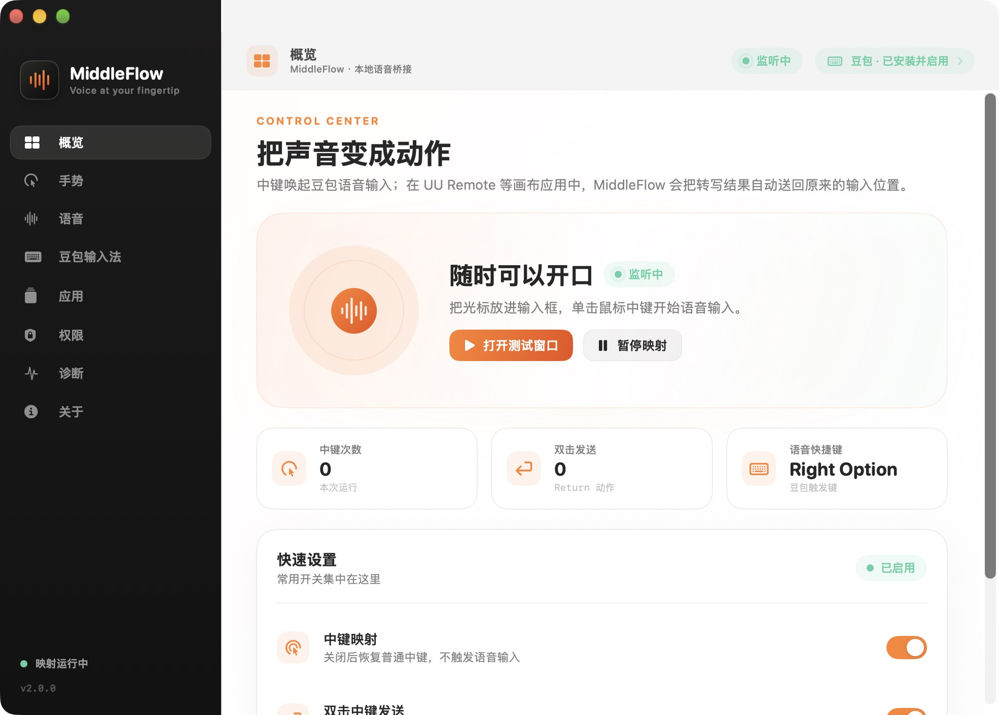
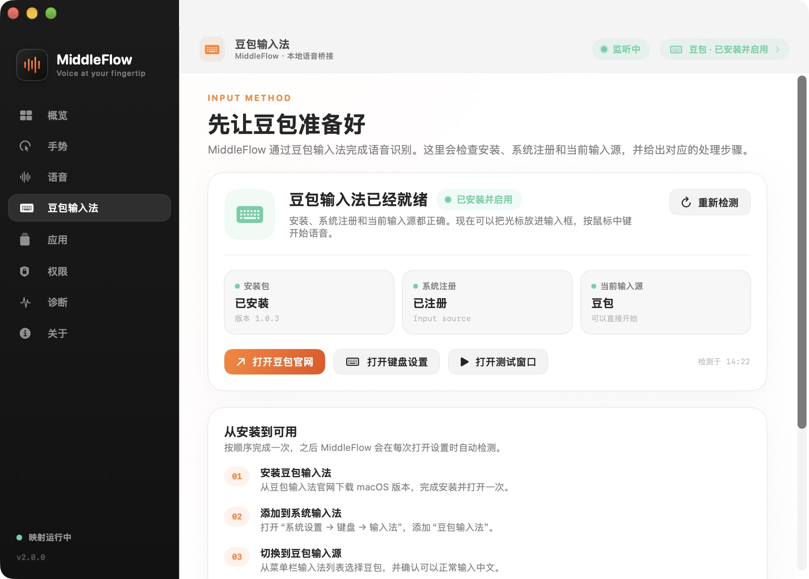

# MiddleFlow

**Voice at your fingertip.**

[中文](README.zh-CN.md) | [English](README.en.md)

MiddleFlow turns a mouse middle click into a voice-input trigger. It is built for workflows that ordinary text-field automation does not handle well: UU Remote, remote desktops, cloud PCs, virtual machines, and canvas-based apps where the target input box cannot be inspected through Accessibility.

The app is local-first. It does not record audio, store transcript text in diagnostics, or upload anything. Doubao input method performs the transcription; MiddleFlow only handles the mouse gesture, keyboard shortcut, and clipboard handoff.





## Platform support

| Platform | Status | Default voice shortcut |
| --- | --- | --- |
| macOS 13+ | Available; event chain verified on the local development build | Right Option |
| Windows 10/11 | Preview; WPF host and core build verified | Long-press Right Alt |

See [docs/windows.md](docs/windows.md) for the Windows scope and verification boundaries.

## Highlights

- Single middle click: start or stop voice input.
- Double middle click: send Return. During a voice session, Return waits until the transcript has been pasted.
- Doubao input-method detection: checks the installed bundle, system registration, current input source, and version, then shows the appropriate setup step.
- Doubao-style floating composer for UU Remote and other canvas apps.
- Automatic paste: restores the target app, returns to the original input point, and sends `Cmd+V` after transcription.
- Clipboard protection: restores the previous clipboard only if it has not changed.
- Menu bar controls: open settings, pause/resume mapping, test, paste the latest transcript, check permission, open diagnostics, and quit.
- Native settings window: the top bar shows the current page, mapping state, and Doubao state; pages include Overview, Gestures, Voice, Doubao Input Method, Apps, Permissions, Diagnostics, and About.
- Universal macOS build: Apple Silicon and Intel.
- No audio capture and no transcript text in diagnostics.

## Install on macOS

### Release build

Download the latest `MiddleFlow-*-macOS-universal.zip` or `.dmg` from GitHub Releases.

The current local build is signed with an Apple Development certificate. Public distribution must additionally be signed with **Developer ID Application** and notarized by Apple. Until that is available, downloaded builds may show the standard Gatekeeper warning. Do not disable Gatekeeper or modify TCC as an installation workaround.

### Build from source

Requirements:

- macOS 13 or newer
- Xcode 15 or newer
- `xcodegen` (only needed for the app bundle script)
- Python 3 with Pillow (only needed to regenerate the icon)

```sh
cd MiddleFlow
swift test
MIDDLEFLOW_SIGN_IDENTITY="Apple Development: Your Name (TEAMID)" \
  ./scripts/build_app.sh
open build/MiddleFlow.app
```

To create the zip and DMG:

```sh
./scripts/package_release.sh 2.0.0
```

Artifacts are written to `dist/`.

### Migrating from the local prototype

If this Mac already has Accessibility permission for `local.leicheng.middle-option-bridge`, a local migration build can reuse that TCC identity:

```sh
MIDDLEFLOW_SIGN_IDENTITY="Apple Development: Your Name (TEAMID)" \
  ./scripts/build_local_legacy.sh
```

That script is intentionally local-only. Public builds use `io.github.leicheng42.middleflow` and do not inherit the legacy Bundle ID's Accessibility authorization, so they require a new grant.

## First run

1. Download and install the macOS version of Doubao input method from <https://shurufa.doubao.com/>.
2. Open **System Settings → Keyboard → Input Sources** and add **Doubao Input Method**.
3. Select Doubao from the menu bar input-source menu and confirm that Chinese input works.
4. In Doubao's voice settings, set the toggle/免按模式 shortcut to **Right Option**. MiddleFlow sends Right Option by default (keycode 61).
5. Open MiddleFlow and grant **Accessibility** on the **Permissions** page.
6. Open the **Doubao Input Method** page and click **Check Again**. The status should show **Installed and enabled**; the settings top bar updates as well.
7. Open **Voice Test Window**, put the caret in the text field, and single-click the middle button to run the full chain.

The event tap retries automatically when permission becomes available. A restart is normally not required. If the top bar says **Waiting for permission**, check the MiddleFlow switch in System Settings and run the check again.

## Daily use

### Normal macOS apps

Put the caret in an editable text field:

- **Single middle click**: send the configured voice shortcut and start or stop voice input.
- **Double middle click**: send Return.
- During a voice session, a double click stops voice input, waits for the transcript to be pasted, and then sends Return.

### UU Remote and canvas apps

UU Remote is included in the composer target list by default. Add other apps on the **Apps** page.

1. Focus the input box in the remote or canvas app.
2. Single-click the middle button to start voice input.
3. Single-click again to stop, or double-click to stop and queue Return.
4. MiddleFlow captures the stable transcript, restores the target window, and sends `Cmd+V` at the original input point.

Clipboard synchronization must be enabled in the remote app. MiddleFlow can confirm that the paste shortcut was sent, but it cannot read the guest input contents. If the target cannot be confirmed as frontmost, MiddleFlow keeps the latest transcript on the clipboard and shows **Copied. Press Cmd+V to paste.**

### Transcript speed

MiddleFlow no longer waits for the input method to clear marked text. Once Doubao has produced text, the app commits the current composition when the text is non-empty, at least about 0.20 seconds have elapsed since stopping, and the text has been stable for about 0.12 seconds. The clipboard/paste flow starts immediately; non-empty text has a 1.20-second fallback, while an empty result is not reported until 2.50 seconds.

This fixes two common failures:

- Doubao already shows the complete text, but MiddleFlow still reports that transcription is not complete.
- The app waits several seconds before pasting, causing visible lag in UU Remote or a chat input box.

### Menu bar and controls

Click the **MiddleFlow** menu bar item:

- **Open MiddleFlow**: show the settings window again.
- **Pause Middle-Click Mapping / Enable Middle-Click Mapping**: restore the ordinary middle click immediately without quitting.
- **Open Voice Test Window**: verify the middle click, Doubao, and microphone chain.
- **Paste Latest Transcript**: manually paste the latest transcript into the current input field.
- **Check Accessibility Permission**: open the relevant System Settings page.
- **Open Diagnostics**: inspect event states, character counts, and errors without transcript text.
- **Quit MiddleFlow**: stop mapping and quit. If launch at login is enabled, the app starts again at the next login.

Closing the settings window only hides it; mapping continues. After quitting, reopen the app from **Applications**, Spotlight, or:

```sh
open /Applications/MiddleFlow.app
```

The local legacy build may be located at:

```sh
open /Applications/MiddleOptionBridge.app
```

If the menu bar icon is hidden by macOS, reopen the app to restore it. You can also pause mapping in Settings to temporarily return the middle click to other apps.

## Permissions and privacy

MiddleFlow needs Accessibility permission to intercept CG button 2 and post keyboard events. It does not capture audio, read screen contents, or store transcript text.

Diagnostics record event types, state transitions, character counts, versions, and errors. Ordinary typed keys, transcript text, and audio are never written to the log.

See [PRIVACY.md](PRIVACY.md) and [SECURITY.md](SECURITY.md).

## Development and architecture

```text
Sources/MiddleFlow/
  App/          macOS lifecycle, menu bar, settings window, test window
  Core/         event tap, gestures, shortcuts, clipboard, permissions, Doubao detection
  UI/           native SwiftUI settings pages and AppKit composer
Tests/          gesture, target policy, preferences, and Doubao status tests
windows/        Windows 10/11 preview: WPF host, tray, settings pages, mouse hook, overlay
```

The macOS UI layer is isolated from the event tap and clipboard core. Settings use SwiftUI; the composer, menu bar item, and translucent panels use AppKit. See [docs/architecture.md](docs/architecture.md) for details.

### About Migo

No usable public Migo macOS/Swift framework could be found. To avoid inventing a fake dependency, this project uses native SwiftUI + AppKit and keeps the UI under `Sources/MiddleFlow/UI/`. A private Migo package or `.xcframework` can replace the UI layer later without changing the event-tap core.

## Windows preview

The Windows edition follows the same product interaction and lives under `windows/`:

- Doubao input method for Windows
- Long-press Right Alt by default
- Global middle-click mapping
- UU Remote overlay
- Automatic paste and clipboard restoration
- System tray, settings, diagnostics, and single-instance protection

Current status:

- `dotnet build windows/MiddleFlow.Windows.sln -c Release -p:EnableWindowsTargeting=true` passes with 0 warnings and 0 errors.
- Both console smoke-test harnesses pass, including the Win32 `INPUT` layout check.
- Self-contained single-file publishing is verified for `win-x64` and `win-arm64`.
- A Windows CI workflow is present but has not produced a recorded run yet. Real Windows 10/11 runtime acceptance and a signed installer remain pending.

Windows packages are named `MiddleFlow-<version>-win-x64.zip` and `MiddleFlow-<version>-win-arm64.zip`. Unzip and run `MiddleFlow.exe`.

See [docs/windows.md](docs/windows.md) for install, build, test, and verification details. The Windows Doubao download page is <https://shurufa.doubao.com/pc>.

## Known limitations

- A public macOS release still needs Developer ID signing and notarization. Apple Development builds are for local testing only.
- Middle click is intercepted globally for all mice. Pause mapping when you need the ordinary middle click.
- The composer relies on the target app accepting clipboard paste; some remote apps may require a different paste shortcut.
- Return submission depends on the target application. Some fields insert a newline instead.
- The Windows preview has a verified cross-platform build, passing smoke tests, and dual-architecture publish output, but the mouse hook, Doubao IME, and UU Remote still need real Windows hardware acceptance.
- The app is not affiliated with Doubao, UU Remote, or Logitech.

## Verification

See [docs/verification-2.0.md](docs/verification-2.0.md) for recorded macOS unit tests and event-tap checks. Doubao detection uses the system input-source API and never reads transcript content.

See [docs/windows.md](docs/windows.md) for the Windows build, core smoke tests, and remaining real-device acceptance checks.

## License

MIT. See [LICENSE](LICENSE).
