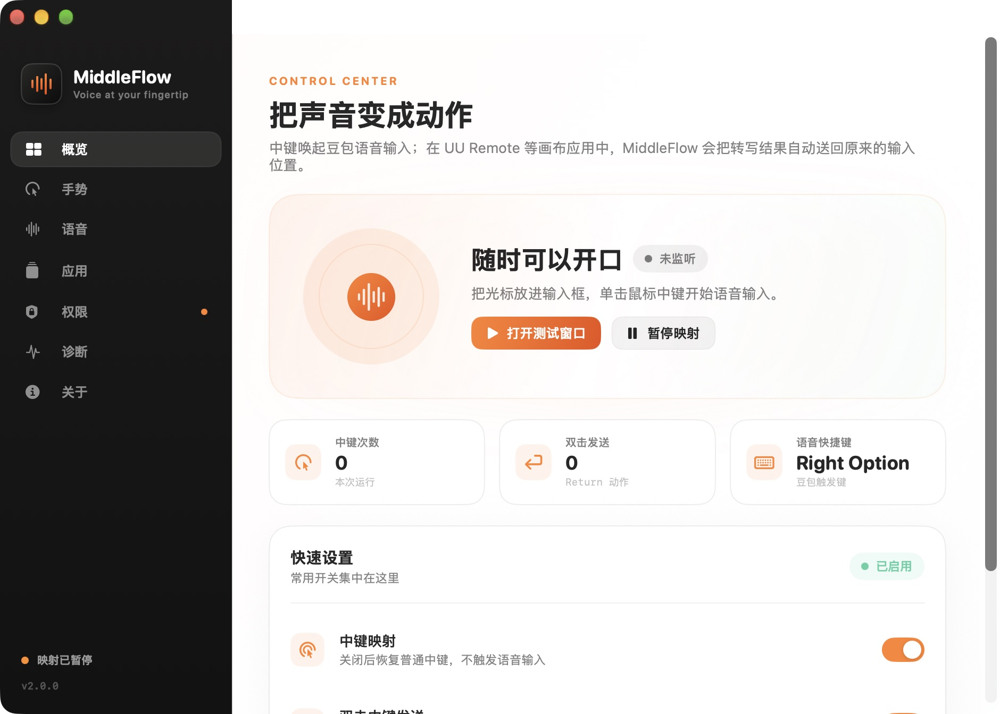

# MiddleFlow

**Voice at your fingertip.**

MiddleFlow turns a mouse middle click into a voice-input trigger for macOS. It is designed for the workflows that ordinary dictation tools do not handle well: UU Remote, remote desktops, cloud PCs, virtual machines, and canvas-based apps where the target input box cannot be inspected by Accessibility.

The app is local-first. It does not record audio, store transcript text in logs, or upload anything.



## Highlights

- Middle click -> configurable voice shortcut, defaulting to **Right Option** for Doubao.
- Single click starts or stops voice input.
- Double click sends **Return**. In a voice session it waits until the transcript has been pasted before sending Return.
- A Doubao-style floating composer for UU Remote and other canvas apps.
- Automatic clipboard handoff and `Cmd+V` after transcription, with a manual-paste fallback.
- Configurable composer targets, shortcut, auto-paste, Return behavior, and clipboard restoration.
- Menu bar control and a full native settings window.
- Universal build: Apple Silicon + Intel.
- No audio capture and no transcript content in diagnostics.

## Install

### Release build

Download the latest `MiddleFlow-*-macOS-universal.zip` or `.dmg` from GitHub Releases.

The current local build is signed with an Apple Development certificate. A public build must additionally be signed with **Developer ID Application** and notarized by Apple. Until that certificate is available, macOS may show the standard Gatekeeper warning for downloaded builds. Do not disable Gatekeeper or modify TCC as an installation workaround.

### Build from source

Requirements:

- macOS 13 or newer
- Xcode 15 or newer
- `xcodegen` (only needed for the app bundle script)
- Python 3 with Pillow (only needed to regenerate the icon)

```sh
cd MiddleFlow
swift test
MIDDLEFLOW_SIGN_IDENTITY="Apple Development: Your Name (TEAMID)" ./scripts/build_app.sh
open build/MiddleFlow.app
```

To create the zip and DMG:

```sh
./scripts/package_release.sh 2.0.0
```

Artifacts are written to `dist/`.

## First run

1. Open MiddleFlow.
2. Open **权限** in the settings window.
3. Grant **Accessibility** permission to `MiddleFlow` in System Settings.
4. Set Doubao's toggle shortcut to **Right Option** (the default in MiddleFlow).
5. Put the caret in a text field and click the middle mouse button.

The event tap retries automatically when permission becomes available. A restart is normally not required.

## Use

### Normal macOS apps

Put the caret in an editable text field:

- **Single middle click**: send the configured voice shortcut.
- **Double middle click**: send Return.

### UU Remote and canvas apps

Add the app under **应用** if it is not already listed. UU Remote is included by default.

1. Focus the remote input box.
2. Single click the middle button.
3. Speak.
4. Single click again to stop, or double click to stop and send Return after the paste.
5. MiddleFlow captures the final transcript, restores the target window, and sends `Cmd+V`.

The remote application may synchronize the clipboard asynchronously. If MiddleFlow cannot confirm the target is frontmost, it keeps the transcript on the clipboard and shows **已复制，请按 Cmd+V 粘贴**.

UU Remote's own clipboard synchronization must be enabled. Remote desktops expose their guest input as a video canvas, so the app can verify that `Cmd+V` was sent but cannot read the guest input contents back.

### Menu bar

The `MiddleFlow` menu bar item provides:

- Open the settings window
- Pause or resume mapping
- Open the safe voice test window
- Paste the latest transcript
- Check Accessibility permission
- Open diagnostics
- Quit

When mapping is paused, the original middle click is restored immediately.

## Permissions and privacy

MiddleFlow needs Accessibility permission to intercept CG button 2 and post keyboard events. It does not capture audio or read screen contents.

Diagnostics record event types, state transitions, character counts, and errors. They do not record transcript text, ordinary typed keys, or audio.

See [PRIVACY.md](PRIVACY.md) and [SECURITY.md](SECURITY.md).

## Architecture

```text
Sources/MiddleFlow/
  App/          lifecycle, menu bar, settings/test windows
  Core/         event tap, gestures, shortcuts, clipboard, permissions
  UI/           native SwiftUI settings pages and AppKit composer
Tests/          pure gesture, target policy, and preference tests
```

The UI layer is deliberately isolated from the event tap and clipboard core. The app uses SwiftUI for settings and AppKit for the floating composer, menu bar item, and translucent panels.

### About Migo

The requested **Migo** UI framework could not be found as a public Swift/macOS package, in the local Xcode/SwiftPM caches, in installed frameworks, or on GitHub/Gitee. The namesake projects found were a React component library, a Go service framework, and an HTML5 game runtime, none of which can provide a native macOS UI.

To avoid inventing a fake dependency, this release uses a native SwiftUI + AppKit design system. It is isolated under `Sources/MiddleFlow/UI/` so a private Migo package or `.xcframework` can be integrated later without changing the event tap or voice-session core.

## Development

```sh
swift test
xcodegen generate --spec project.yml
```

The tests do not need Accessibility permission or a foreground window. Integration checks that touch the real event tap and microphone should be run explicitly with the test window.

## Known limitations

- A public release needs Developer ID signing and notarization. Apple Development builds are for local testing.
- Middle click is intercepted globally for all mice. Pause mapping when you need the ordinary middle click.
- The floating composer relies on the target application accepting clipboard paste; some remote apps may require a different paste shortcut.
- Return submission depends on the remote application. Fields that insert newlines will add a newline.
- The app is not affiliated with Doubao, UU Remote, or Logitech.

## License

MIT. See [LICENSE](LICENSE).
