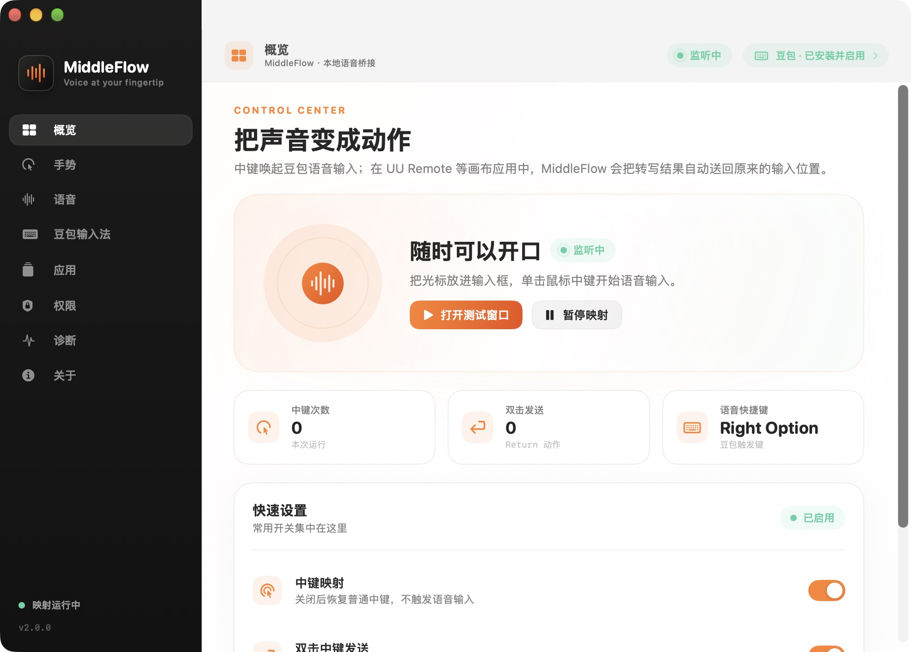
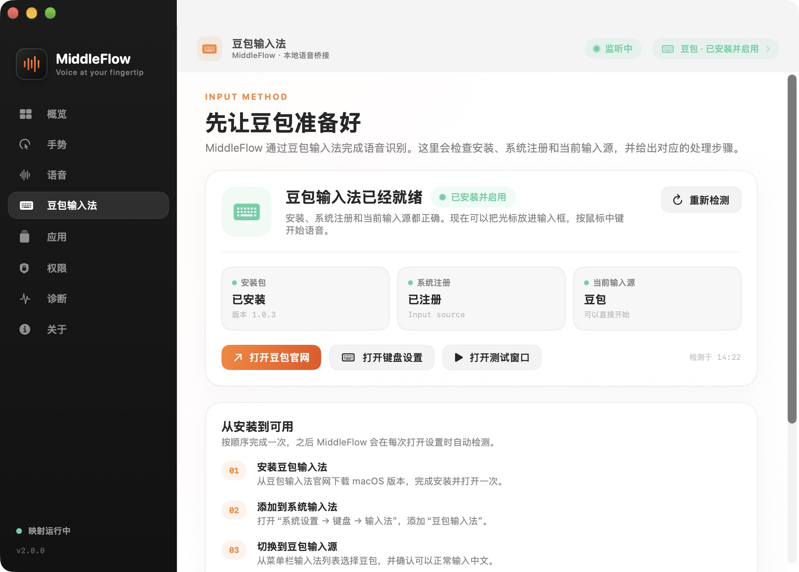

# MiddleFlow

**Voice at your fingertip.**

[中文](README.zh-CN.md) | [English](README.en.md)

MiddleFlow 把鼠标中键变成语音输入入口。它面向普通输入框难以直接读取或自动化的场景：UU Remote、远程桌面、云电脑、虚拟机，以及以画布方式渲染输入框的应用。

应用坚持本地优先：不录音、不保存转写正文、不上传内容。转写由你选择的豆包输入法完成，MiddleFlow 只负责鼠标手势、快捷键和剪贴板交接。





## 平台支持

| 平台 | 状态 | 默认语音快捷键 |
| --- | --- | --- |
| macOS 13+ | 可用；本地开发构建已验证事件链路 | 右侧 Option（Right Option） |
| Windows 10/11 | 预览版；WPF host 和 core 已构建验证 | 长按右侧 Alt（Right Alt） |

Windows 的功能范围与验证边界见 [docs/windows.md](docs/windows.md)。

## 核心功能

- 单击中键：开始或停止语音输入。
- 双击中键：发送 Return；如果正在语音流程中，会等待转写粘贴完成后再发送。
- 豆包输入法检测：检查安装包、系统注册、当前输入源和版本，并给出安装或切换指引。
- 豆包风格浮层：在 UU Remote 等画布应用中显示独立输入面板。
- 自动粘贴：转写完成后恢复目标应用、定位原输入位置并发送 `Cmd+V`。
- 剪贴板保护：粘贴后仅在剪贴板未被改动时恢复原内容。
- 菜单栏控制：打开设置、暂停/开启映射、测试、粘贴最新转写、检查权限、查看日志和退出。
- 原生设置窗口：顶栏显示当前页面、映射状态和豆包状态；包含概览、手势、语音、豆包输入法、应用、权限、诊断和关于页面。
- Universal macOS 构建：同时支持 Apple Silicon 和 Intel。
- 不采集音频，不在诊断日志中记录转写正文或普通按键内容。

## 安装 macOS 版

### 下载发布包

从 GitHub Releases 下载最新的 `MiddleFlow-*-macOS-universal.zip` 或 `.dmg`。

当前本地开发包使用 Apple Development 证书签名。公开分发还需要 **Developer ID Application** 签名并经过 Apple notarization；在完成这一步之前，下载包可能触发 Gatekeeper 提示。请不要通过关闭 Gatekeeper 或修改 TCC 数据库来绕过安装限制。

### 从源码构建

环境要求：

- macOS 13 或更高版本
- Xcode 15 或更高版本
- `xcodegen`（仅构建 app bundle 时需要）
- Python 3 与 Pillow（仅重新生成图标时需要）

```sh
cd MiddleFlow
swift test
MIDDLEFLOW_SIGN_IDENTITY="Apple Development: Your Name (TEAMID)" \
  ./scripts/build_app.sh
open build/MiddleFlow.app
```

生成 zip 和 DMG：

```sh
./scripts/package_release.sh 2.0.1
```

产物位于 `dist/`。

### 从本地旧版迁移

如果这台 Mac 已经给 `local.leicheng.middle-option-bridge` 授予过辅助功能权限，可以用本地迁移构建复用原 TCC 身份：

```sh
MIDDLEFLOW_SIGN_IDENTITY="Apple Development: Your Name (TEAMID)" \
  ./scripts/build_local_legacy.sh
```

该脚本只用于本机迁移。公开构建使用 `io.github.leicheng42.middleflow`，不会继承旧 Bundle ID 的辅助功能授权，需要重新授权。

## 首次使用

1. 从豆包输入法官网下载并安装 macOS 版：<https://shurufa.doubao.com/>。
2. 打开 **系统设置 → 键盘 → 输入法**，添加“豆包输入法”。
3. 从菜单栏输入法列表切换到豆包，确认可以正常输入中文。
4. 在豆包输入法的语音设置中，把“免按模式”快捷键设为 **右侧 Option**。MiddleFlow 默认发送的也是 Right Option（keycode 61）。
5. 打开 MiddleFlow，在 **权限** 页面授予 **辅助功能** 权限。
6. 打开 **豆包输入法** 页面，点击 **重新检测**。状态应显示“已安装并启用”；设置窗口顶栏也会同步显示豆包状态。
7. 打开 **打开语音测试窗口**，把光标放进输入框，单击中键完成一次完整测试。

权限生效后事件监听会自动重试，通常不需要重启应用。如果顶栏显示“待授权”，先检查系统设置中的 MiddleFlow 开关，再回到应用点击重新检测。

## 日常使用

### 普通 macOS 应用

把光标放进可编辑输入框：

- **单击中键**：发送当前语音快捷键，开始或停止语音输入。
- **双击中键**：发送 Return。
- 在语音会话中双击：停止语音，等待转写粘贴完成，再发送 Return。

### UU Remote 与画布应用

UU Remote 默认已加入浮层目标列表。其他应用可在 **应用** 页面添加。

1. 聚焦远程或画布应用里的输入框。
2. 单击中键开始语音。
3. 说完后再次单击停止；也可以双击停止并排队发送 Return。
4. MiddleFlow 捕获稳定后的转写，恢复目标窗口，并在原输入位置发送 `Cmd+V`。

远程应用需要启用剪贴板同步。MiddleFlow 可以确认已发送粘贴快捷键，但不能读取远程客户机里的输入框内容；如果无法确认目标窗口在前台，会保留最新转写到剪贴板，并提示 **已复制，请按 Cmd+V 粘贴**。

### 转写速度

MiddleFlow 不再等待输入法清除 marked text。豆包已经写出文字后，只要文本非空、停止录音至少约 0.20 秒，并且内容连续约 0.12 秒没有变化，就会提交当前组合文本并立即进入剪贴板/粘贴流程；非空文本 1.20 秒兜底，空文本 2.50 秒才提示失败。

这修复了两个常见问题：

- 豆包已经显示完整文字，但 MiddleFlow 仍报“转写尚未完成”。
- 必须等待数秒才粘贴，导致 UU Remote 或聊天输入框出现明显卡顿。

### 菜单栏与开关

点击菜单栏的 **MiddleFlow** 图标：

- **打开 MiddleFlow**：重新打开设置窗口。
- **暂停中键映射 / 开启中键映射**：暂停后立即恢复普通中键；不会退出应用。
- **打开语音测试窗口**：验证中键、豆包和麦克风链路。
- **粘贴最新转写**：手动把最近一次转写粘贴到当前输入框。
- **检查辅助功能权限**：打开权限相关系统设置。
- **打开诊断日志**：查看事件状态、字符数和错误，不包含转写正文。
- **退出 MiddleFlow**：停止映射并退出；如果启用了登录启动，下次登录会再次启动。

关闭设置窗口只会隐藏窗口，不会停止中键映射。完全退出后，可从 **应用程序**、Spotlight 或以下命令重新打开：

```sh
open /Applications/MiddleFlow.app
```

本地 legacy 构建的路径可能是：

```sh
open /Applications/MiddleOptionBridge.app
```

如果菜单栏图标被系统挤掉，重新打开应用即可恢复；也可以在设置中暂停映射，临时把中键还给其他应用。

## 权限与隐私

MiddleFlow 需要辅助功能权限，才能拦截 CG button 2 并发送键盘事件。它不读取屏幕内容、不录音，也不保存转写正文。

诊断日志只记录事件类型、状态转换、字符数、版本和错误。普通按键、转写文本和音频不会写入日志。

详见 [PRIVACY.md](PRIVACY.md) 和 [SECURITY.md](SECURITY.md)。

## 开发与架构

```text
Sources/MiddleFlow/
  App/          macOS 生命周期、菜单栏、设置窗口和测试窗口
  Core/         事件监听、手势、快捷键、剪贴板、权限、豆包检测
  UI/           原生 SwiftUI 设置页和 AppKit 浮层
Tests/          手势、目标策略、偏好设置和豆包状态测试
windows/        Windows 10/11 预览版：WPF host、托盘、设置页、鼠标钩子和浮层
```

macOS 的 UI 层与事件监听、剪贴板核心隔离。设置页使用 SwiftUI，浮层、菜单栏和半透明面板使用 AppKit。详细设计见 [docs/architecture.md](docs/architecture.md)。

### 关于 Migo

目前没有找到可用的公开 Migo macOS/Swift 框架。为避免伪造依赖，本项目使用原生 SwiftUI + AppKit，并把 UI 集中在 `Sources/MiddleFlow/UI/`；如果以后有可用的私有 Migo 包或 `.xcframework`，可以在不改动事件监听核心的前提下替换 UI 层。

## Windows 预览版

Windows 版采用与 macOS 相同的产品交互，代码位于 `windows/`：

- 豆包输入法 for Windows
- 默认长按右侧 Alt
- 全局中键映射
- UU Remote 浮层
- 自动粘贴与剪贴板恢复
- 系统托盘、设置页面、诊断和单实例保护

当前状态：

- `dotnet build windows/MiddleFlow.Windows.sln -c Release -p:EnableWindowsTargeting=true` 已通过，0 warning、0 error。
- 两个 console smoke test 均已通过，包括 Win32 `INPUT` 结构布局检查。
- `win-x64` 与 `win-arm64` self-contained single-file 发布均已验证。
- Windows CI 已在 GitHub Actions 的 `windows-latest` 上通过 x64 与 ARM64 两个矩阵任务；真实 Windows 10/11 运行时验收和签名安装器仍待完成。

发布包命名为 `MiddleFlow-<version>-win-x64.zip` 和 `MiddleFlow-<version>-win-arm64.zip`，解压后直接运行 `MiddleFlow.exe`。

安装、构建、测试命令和验证清单见 [docs/windows.md](docs/windows.md)。豆包 Windows 版下载页为 <https://shurufa.doubao.com/pc>。

## 已知限制

- 公开 macOS 发布包仍需要 Developer ID 签名和 notarization；Apple Development 构建只适合本地测试。
- 中键会对所有鼠标全局生效；需要普通中键时请暂停映射。
- 浮层依赖目标应用接受剪贴板粘贴，少数远程应用可能需要不同的粘贴快捷键。
- Return 是否提交由目标应用决定；有些输入框会把 Return 解释为换行。
- Windows 预览版已完成跨平台构建、smoke tests 和双架构发布，但尚未在真实 Windows 机器上完成鼠标钩子、豆包 IME 和 UU Remote 的运行时验收。
- 本项目与豆包、UU Remote、Logitech 没有关联。

## 验证

macOS 单元测试和事件监听记录见 [docs/verification-2.0.md](docs/verification-2.0.md)。豆包检测页面的状态来自系统输入源 API，不读取转写内容。

Windows 的构建、核心 smoke tests 和仍待执行的实机验收项见 [docs/windows.md](docs/windows.md)。

## License

MIT，见 [LICENSE](LICENSE)。
